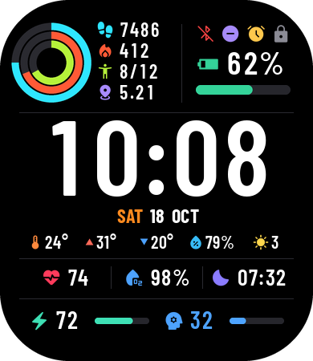

# Bip6 Health

A health- and time-focused watchface for the **Amazfit Bip 6** (Zepp OS, API level 3.0+).



| Area | Shows | Tap opens |
|---|---|---|
| Top left | Activity rings (steps / calories / stand goal) · steps · kcal · stand hours (now/goal) · km | Activity |
| Top right | Status icons, each shown only while active: Bluetooth disconnected · DND · alarm set · locked<br>Battery % and bar (green > 40, amber 21–40, red ≤ 20) | – |
| Middle | HH:MM | – |
| Date | Day · date · month, centred | – |
| Weather | Five equal columns: temp · high ▲ · low ▼ · humidity · UV index | Weather |
| Health tiles | Heart rate · SpO₂ · sleep (h:mm) | Heart Rate / Blood Oxygen / Sleep |
| Bottom | HybridCharge 0–100 + bar · Stress 0–100 + bar | – / Stress |
| Always-on | Dim grey time, date, battery | – |

**Dynamic states** (see `preview/alerts.png`):

| Element | Changes |
|---|---|
| Stress | Icon, value and bar coloured by zone: relaxed 1–39 blue · normal 40–59 green · medium 60–79 orange · high 80–100 red |
| Heart rate | White below 60% of max HR (220 − age from your Zepp profile), orange 60–79%, red ≥ 80% |
| SpO₂ | Red below 92% |
| Sleep | Amber under 6 h |
| Weekday | Gold at dawn (sunrise ± 1 h), orange by day, pink at dusk (sunset ± 1 h), blue at night |
| Heart icon | ~3 s "lub-dub" pulse at your current heart rate after each wrist raise |

Device: 1.97" AMOLED, 390 × 450, rounded square (r = 86); deviceSource 9765120, 9765121, 10158337.

## Build and install

Needs Node 22+ and the Zeus CLI.

```sh
npm i -g @zeppos/zeus-cli
zeus build      # writes dist/*.zab
zeus preview    # QR code; scan in the Zepp app (Profile → Settings → About → tap the logo 7× for Developer Mode)
zeus dev        # run in the Zepp OS simulator
```

## Changing the design

Every image is generated, so colours, sizes and icons are edited in one place:

```sh
tools/fetch_fonts.sh          # once: Barlow Condensed + Material Symbols into tools/fonts/
python3 tools/gen_assets.py   # regenerates assets/bip6/** and watchface/metrics.js
npm run preview               # renders preview/normal.png and preview/aod.png from the real index.js
```

`gen_assets.py` also computes the date, weather and tile layouts from the real glyph widths. `npm run preview` runs `watchface/index.js` against a stub of the
watch UI and draws exactly the widgets it creates. The normal render is also saved as
`assets/bip6/icon.png`, the watchface-picker preview.

## Structure

```
app.json               targets, deviceSource, permissions
watchface/index.js     the watchface: widgets, sensor bindings, tap targets
watchface/metrics.js   generated glyph sizes + date row positions
assets/bip6/           generated images (fonts, icons, bars, tap overlays, icon.png)
tools/gen_assets.py    image + metrics generator
tools/preview/         stub renderer for previews
```

## Known limits

- **HybridCharge**: Zepp added it as a watchface data field in 2026, but its `data_type`
  constant isn't in the published API reference. The face looks for a matching
  `hmUI.data_type` key at runtime (`HYBRID…` / `BIO_CHARGE…`). If the firmware has none,
  it shows `--` with an empty bar. The Bip 6 wasn't on Zepp's initial HybridCharge rollout list.
- The HybridCharge bar relies on `IMG_LEVEL` honouring `type`, which Watchface Maker uses
  but the API reference doesn't document.
- The heartbeat retimes `IMG_ANIM` with `setProperty(prop.MORE, { anim_fps, repeat_count })`
  before each start. If the firmware ignores that, it pulses at a fixed 8 fps instead.
- Not yet run on a real watch or in the simulator. `zeus build` compiles cleanly.
- Replace `appId` in `app.json` with one from the Zepp developer console before publishing.
